# Atmosphere Weather for Home Assistant

Atmosphere bundles a weather dashboard, worldwide Open-Meteo forecasts, recent precipitation radar, and native Home Assistant entities. Each saved location updates independently, even with all dashboards closed.

## Watch the dashboard demo

[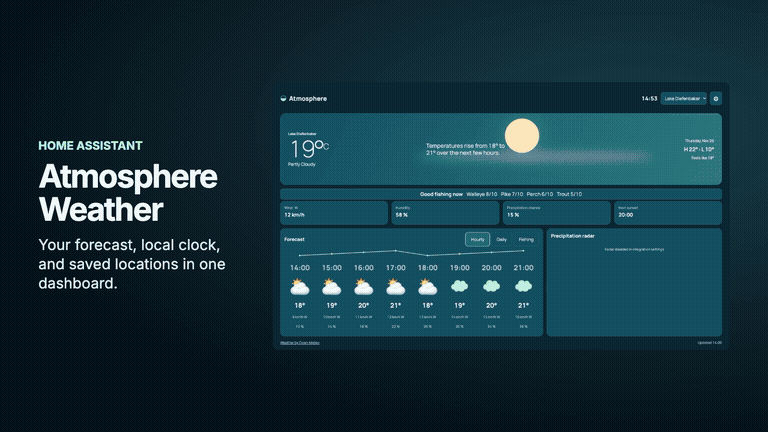](https://github.com/user-attachments/assets/d705aa0d-a89f-4dd0-9074-667555b3e00b)

Tap the preview to open the full-resolution video.

https://github.com/user-attachments/assets/d705aa0d-a89f-4dd0-9074-667555b3e00b

[Download the 25-second demo (MP4)](https://github.com/yanke7/Home-Assistant-weather/releases/download/v0.1.34/atmosphere-weather-demo.mp4). See the dashboard, radar, city cameras, themes, and language settings, plus an example of using weather entities in an automation.

[](https://my.home-assistant.io/redirect/hacs_repository/?owner=yanke7&repository=Home-Assistant-weather&category=integration)

## Install

Atmosphere targets Home Assistant **2026.11 or later**.

1. Search for **Atmosphere Weather** in Home Assistant Marketplace or HACS and select **Download**. If it doesn’t appear in search, add `https://github.com/yanke7/Home-Assistant-weather` as a custom **Integration** repository. For a manual install, extract the release ZIP into the Home Assistant configuration directory so it contains `custom_components/atmosphere_weather/manifest.json`.
2. Restart Home Assistant and add **Atmosphere Weather** through **Settings → Devices & services → Add integration**. The initial form defaults to your Home Assistant location and lets you change it.
3. Add the **Atmosphere Weather** card to a panel dashboard. The integration loads its own card resource. See [the example dashboard](examples/dashboard.yaml).

```yaml
type: custom:atmosphere-weather-card
```

Use a unique optional `storage_key` per dashboard card to keep its browser preferences separate from other cards. An optional `location` config subentry ID sets the initial selection.

## Dashboard features

### Current weather and forecasts

- **Current conditions:** See the location’s temperature, feels-like temperature, forecast high and low, wind speed and direction, humidity, precipitation chance, and the next sunrise or sunset. The briefing summarizes what to expect over the next few hours.
- **Custom weather boxes:** Open **Settings → Weather boxes** and select **Edit** beside a box to preview a reading and give it a custom title. Add up to two extra boxes for landscape. Portrait always shows the first four. Choices are saved for this dashboard in the current browser.
- **Animated sky:** The bundled Three.js scene draws clouds, rain, snow, fog, or stars as conditions change. At night, the Moon shows its phase, and partly cloudy hourly forecasts show a crescent instead of the Sun. The animation pauses offscreen or when the dashboard is in the background. A static sky is available with reduced motion or without WebGL.
- **Hourly and daily forecasts:** Compare conditions, wind, precipitation probability and available rain or snow totals. An hourly temperature trend and a daily high-temperature trend make changes easy to spot. The daily view also shows the forecast low.
- **Forecast details:** Tap current conditions or an hourly or daily column to see all readings available for that period. Use the gear in the panel to choose which readings appear. The panel leaves the forecast columns accessible so you can switch periods while it’s open, and uses two columns when space allows.

### Fishing forecasts

Fishing is built into **Atmosphere Weather**. The integration calculates the forecast and updates its Home Assistant entities even when the dashboard is closed.

1. Open **Atmosphere → Settings → Fishing forecasts** and turn on the master switch.
2. Choose **Edit** beside a saved city or lake. Enable fishing for that location and choose its water type (lake, river, pond, or reservoir).
3. Select up to four species and choose **Save**. Use a separate saved location with the lake’s coordinates if you fish away from the city.
4. Select the location in the dashboard header. The current-weather summary shows each species’ score for the current hour. Open **Fishing** beside **Hourly** and **Daily** to see each day’s peak score for every selected species. Tap a day for the daily averages, best three-hour windows, and hourly scores.

**Seven-day Fishing forecast on desktop**

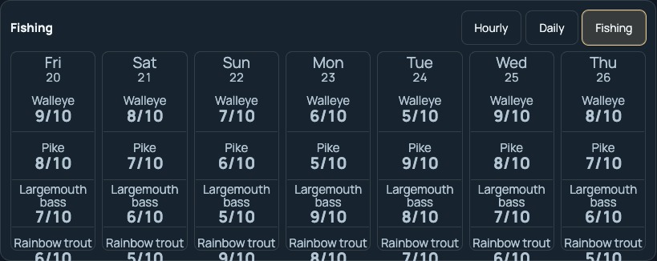

**Fishing forecast on a phone in portrait**

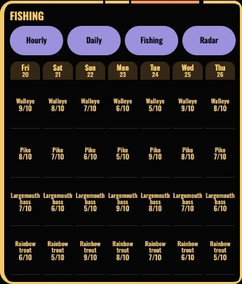

**Day details pop-up**

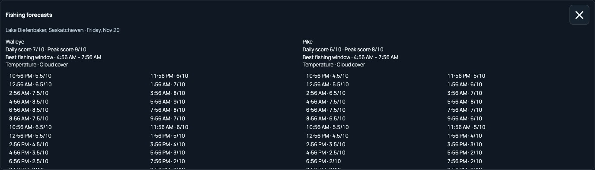

Screenshots use sample data. Ratings combine weather and solar and lunar activity. The calculation uses forecast air temperature as a proxy for water temperature.

#### Get a notification when fishing conditions are good

Under **Settings → Devices & services → Atmosphere Weather**, open the device for your lake and find your species’ **Fishing score now** sensor and **Fishing window active** binary sensor. The integration also creates a **Daily fishing score** sensor and timestamp sensors for the next window’s start and end.

This automation sends a notification when a walleye window opens with a score of at least 7, or when the score reaches 7 during an active window. Replace both example entity IDs with yours and change the notification action to your phone’s service.

```yaml
alias: Walleye fishing window
triggers:
  - trigger: state
    entity_id: binary_sensor.lake_diefenbaker_walleye_fishing_window_active
    to: "on"
  - trigger: numeric_state
    entity_id: sensor.lake_diefenbaker_walleye_fishing_score_now
    above: 6
conditions:
  - condition: state
    entity_id: binary_sensor.lake_diefenbaker_walleye_fishing_window_active
    state: "on"
  - condition: numeric_state
    entity_id: sensor.lake_diefenbaker_walleye_fishing_score_now
    above: 6
actions:
  - action: notify.mobile_app_your_phone
    data:
      title: Walleye fishing window
      message: "The window is open at Lake Diefenbaker. Current score is {{ states('sensor.lake_diefenbaker_walleye_fishing_score_now') }}/10."
mode: single
```

Species profiles are adapted from [Fishing Assistant](https://github.com/bairnhard/fishing_assistant) under the MIT license.

### Precipitation radar and wind rose

- Scrub through recent observed precipitation frames using the time slider.
- Pan the map by dragging, zoom with the **−** and **+** buttons or pinch on a touchscreen, and use **Recenter** to return to the selected location. Higher zoom levels enlarge the available radar tiles.
- Toggle **Wind rose** to show forecast wind direction and speed bands over the next 24 hours.
- On a wide dashboard, the map sits beside the forecast. On a narrow phone, use the **Radar** tab. Short landscape screens can scroll vertically to keep the controls, forecast, and map readable.

### Locations, cameras, and thermostat

- **Saved locations:** Administrators can add up to 20 locations, search by city or postal code, or enter coordinates and an IANA time zone. Switch locations using the dashboard header. Editing a location preserves its entity IDs. Removing it unregisters its entities.
- **Optional camera per location:** Under **Settings → Locations → Edit**, choose a Home Assistant camera or enter a direct browser-playable URL. The preview opens full screen when tapped and closes when tapped again. The dashboard hides the preview for locations without a camera.
- **Camera formats:** Select image mode for MJPEG or a snapshot URL, or video mode for MP4 and browser-native HLS. When a direct video clip ends, the card requests and plays the latest available clip from the same URL. For RTSP, use a Home Assistant camera entity. Use an HTTPS feed for a dashboard served over HTTPS.
- **Home thermostat:** Select a climate entity under **Home thermostat** for the Home location. The card shows the reported room temperature, or the target if room temperature is unavailable. Tap it to open the thermostat dial. Adjust the setpoint with the dial or step buttons, use quick temperature presets, and choose HVAC and fan modes when supported by the climate entity. The panel follows your dashboard colors and uses a segmented climate console in the Star Trek theme. Use the thermostat gear to change all three preset names and temperatures. Presets are shared between the two designs and saved in the browser. The panel shows indoor humidity when the entity reports it.

#### Camera previews on desktop and phone

A camera beside the current conditions lets you compare the forecast with the sky outside. On a phone the preview moves into the lower-right corner of the weather panel. These examples show the same Honolulu camera image with sample weather and thermostat readings.

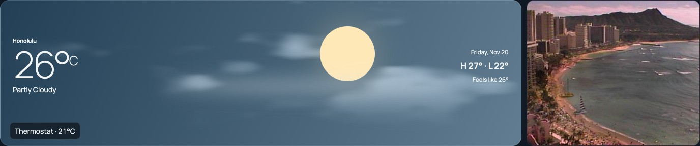

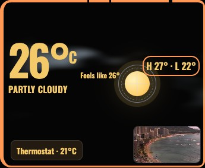

#### Control the Home thermostat

Tap the indoor temperature in the Home weather panel. **Indoor** shows the measured room temperature. The large number in the dial is the target. Tap **+** or **−** to adjust it by one supported step, or tap a named preset to request its temperature.

| Standard thermostat | Star Trek thermostat |
| --- | --- |
| 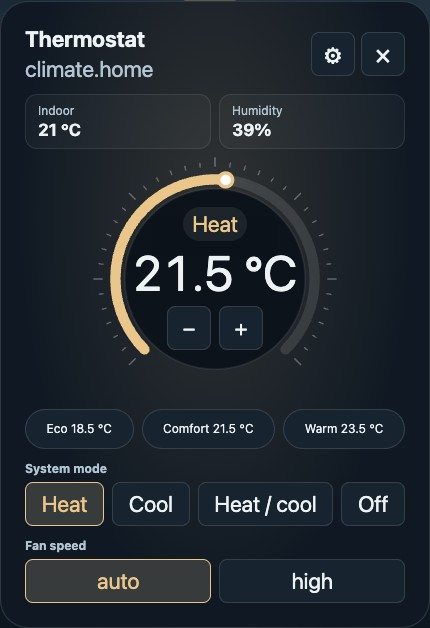 | 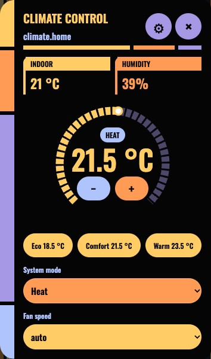 |

Open the thermostat gear, enter the three names and temperatures you want, then tap **Save presets**. Saving edits the shortcuts. Tapping a shortcut applies it to the thermostat.

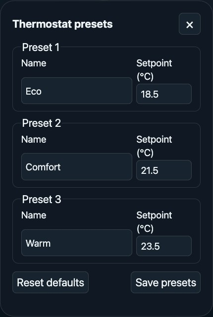

### Appearance, units, and languages

- **Clock format:** Under **Settings → Appearance**, choose the language default, a 12-hour clock, or a 24-hour clock. The choice is saved in your browser for that dashboard.

- **Eight appearance options:** Original, Brushed Steel, Amber Relay, Neon Grid, Midnight Drift, Aqua Current, Star Trek, and Follow Appearance. Follow Appearance uses shared appearance variables when available and falls back to the Home Assistant theme.
- **Metric or imperial display:** Change the dashboard’s display units in Settings. Entity units follow Home Assistant settings.
- **12 dashboard languages:** English, French, Spanish, German, Tagalog, Hindi, Dutch, Swedish, Italian, Polish, Danish, and Norwegian Bokmål. By default, the dashboard follows the Home Assistant profile language and uses English if that language is unsupported. Choose a different language under **Settings → Language** to override it or select **Follow Home Assistant** to switch back. The language changes dashboard labels, weather conditions, and forecast date and time formatting. Official alert titles and descriptions use the issuing agency’s language.
- **Browser preferences:** The card remembers the selected location, theme, display units, language override, wind rose visibility, and chosen forecast readings in the browser.

## Theme gallery

Choose a theme under **Atmosphere → Settings → Appearance**. The screenshots show the same sample forecast. **Follow Appearance** uses the active Home Assistant colors, shown here with an example palette. Click any screenshot to view it full size.

| | |
| --- | --- |
| **Original**<br>[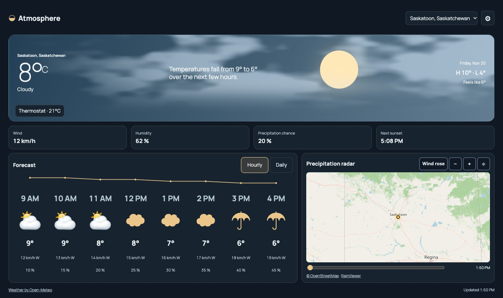](docs/themes/original.jpg) | **Brushed Steel**<br>[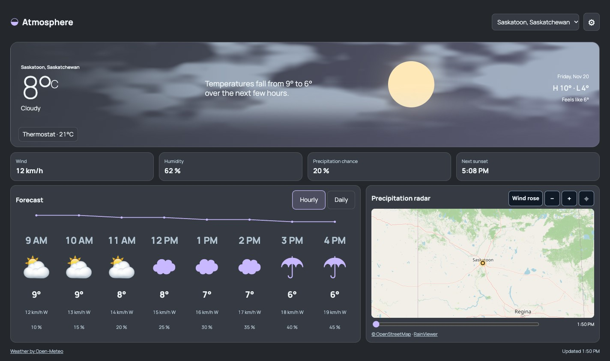](docs/themes/brushed-steel.jpg) |
| **Amber Relay**<br>[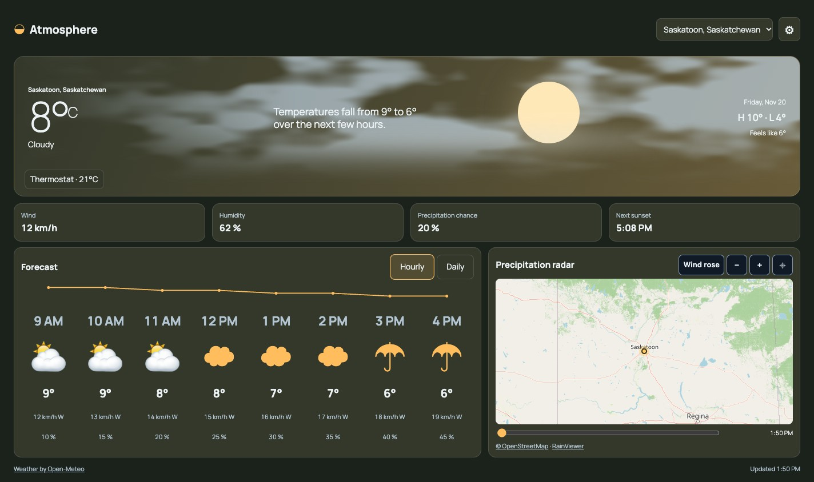](docs/themes/amber-relay.jpg) | **Neon Grid**<br>[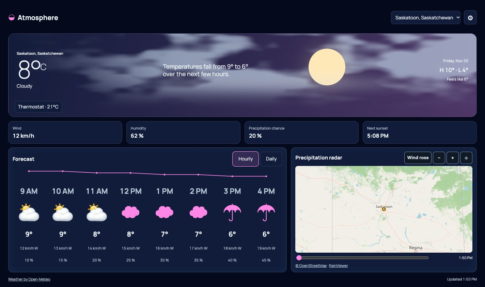](docs/themes/neon-grid.jpg) |
| **Midnight Drift**<br>[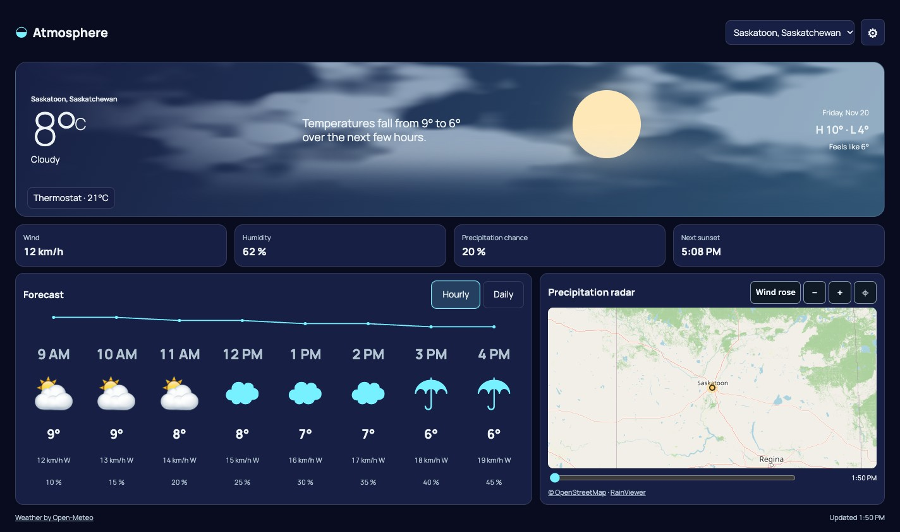](docs/themes/midnight-drift.jpg) | **Aqua Current**<br>[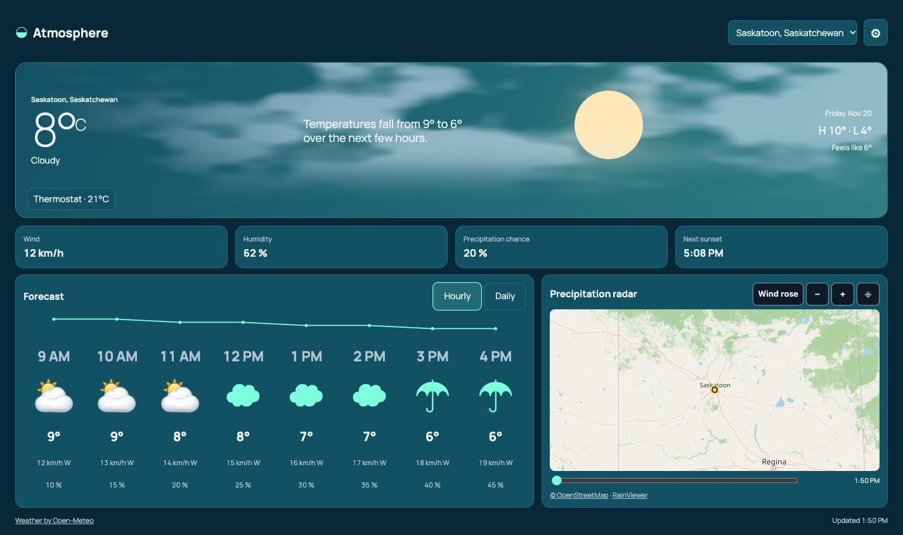](docs/themes/aqua-current.jpg) |
| **Star Trek**<br>[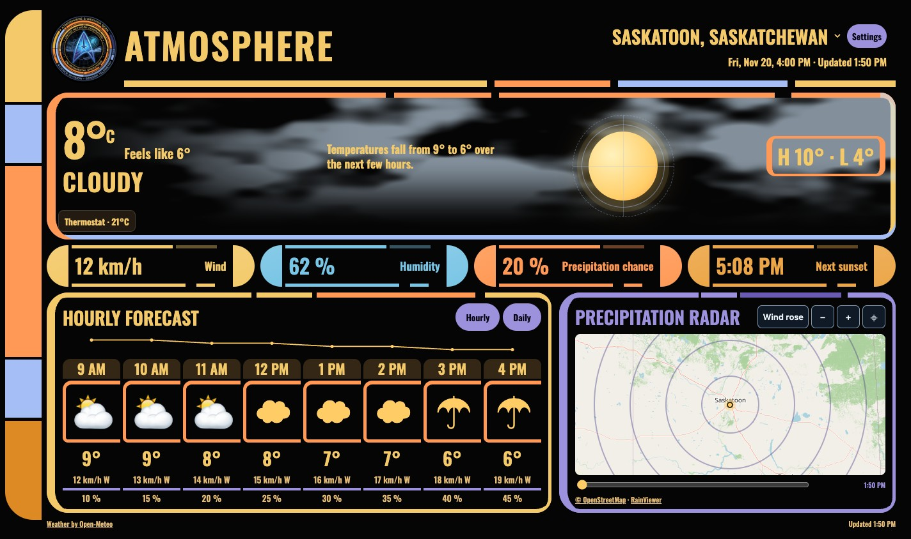](docs/themes/star-trek.jpg) | **Follow Appearance**<br>[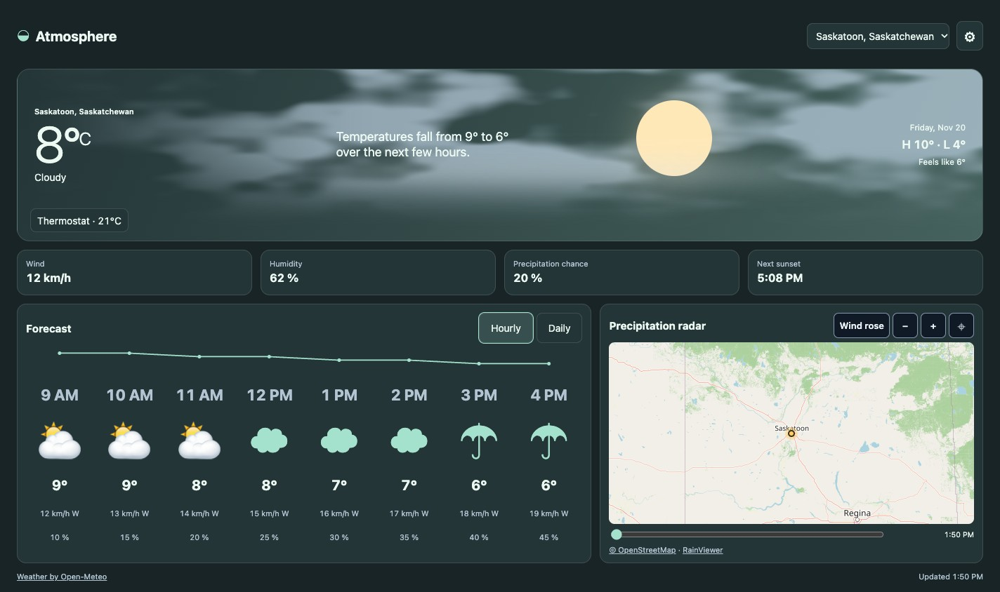](docs/themes/follow-appearance.jpg) |

### Phone portrait screenshots

The same eight appearance options at a 390 px phone viewport. Click any screenshot to open it full size.

| | | | |
| --- | --- | --- | --- |
| **Original**<br>[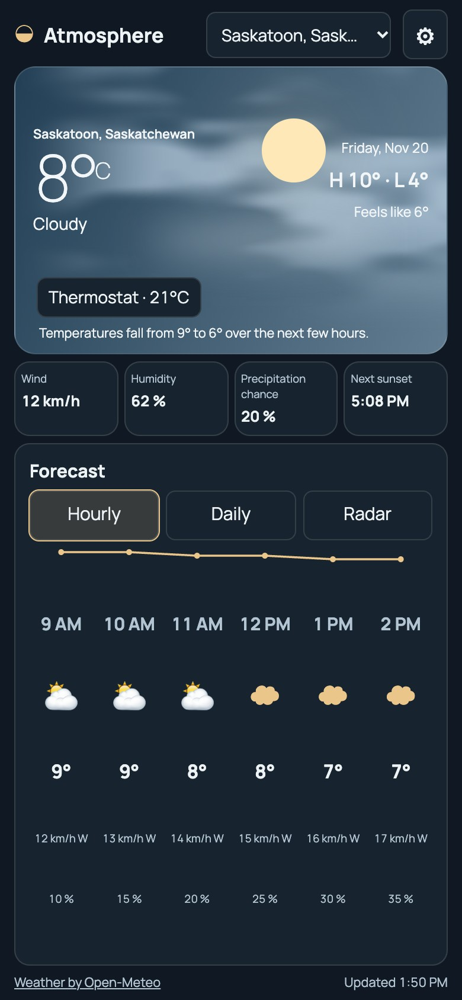](docs/themes/mobile/original.jpg) | **Brushed Steel**<br>[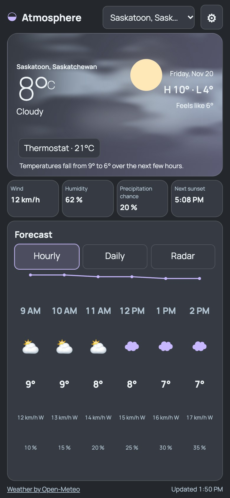](docs/themes/mobile/brushed-steel.jpg) | **Amber Relay**<br>[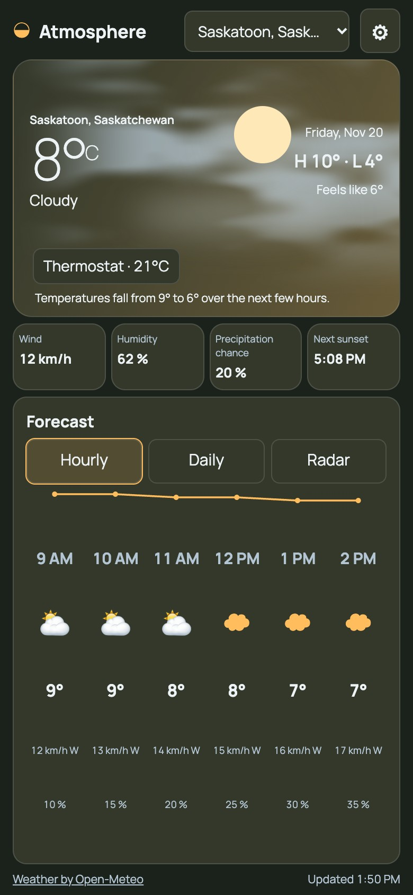](docs/themes/mobile/amber-relay.jpg) | **Neon Grid**<br>[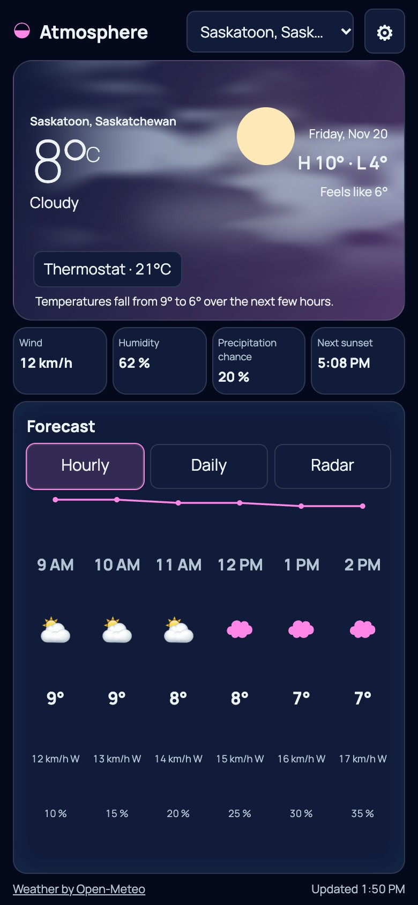](docs/themes/mobile/neon-grid.jpg) |
| **Midnight Drift**<br>[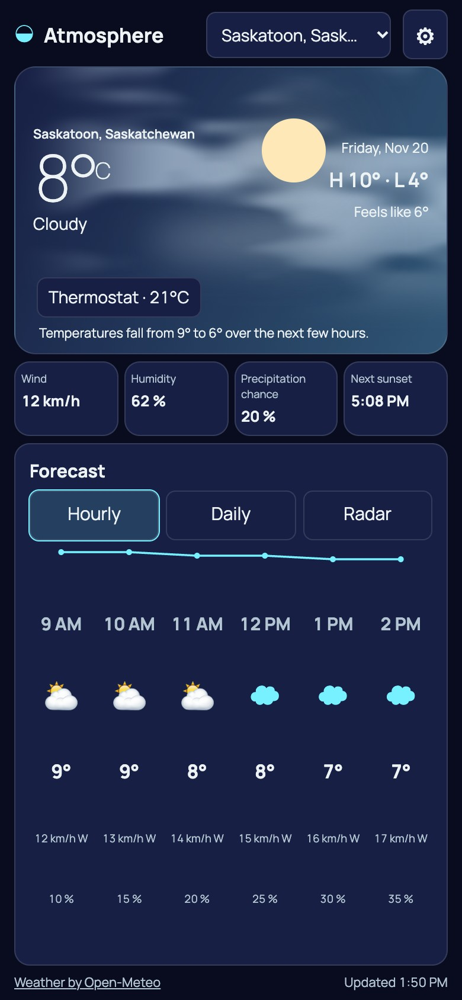](docs/themes/mobile/midnight-drift.jpg) | **Aqua Current**<br>[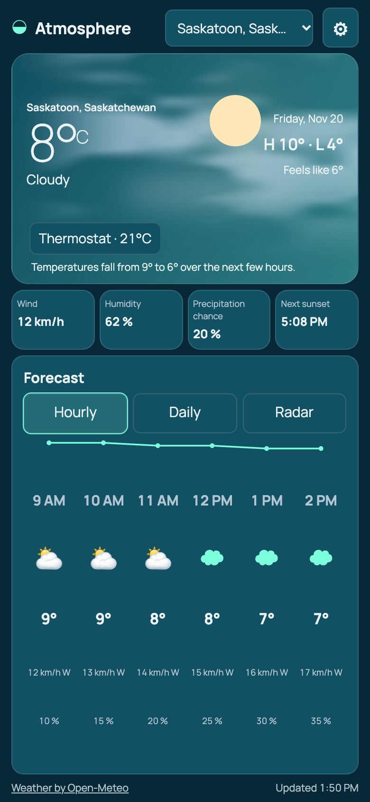](docs/themes/mobile/aqua-current.jpg) | **Star Trek**<br>[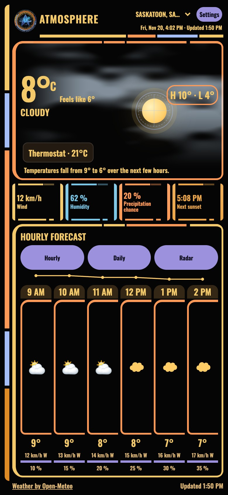](docs/themes/mobile/star-trek.jpg) | **Follow Appearance**<br>[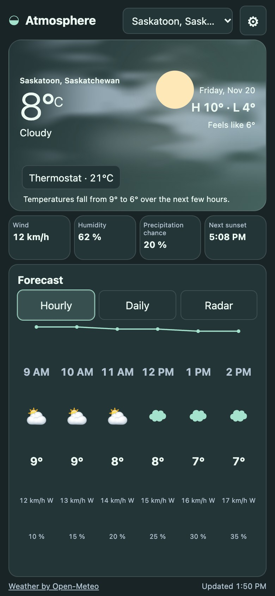](docs/themes/mobile/follow-appearance.jpg) |

[View the portrait Radar tab with the wind rose open](docs/themes/mobile/radar.jpg).

## Automations

Find the device for your location under the integration. Its native weather entity supports `weather.get_forecasts` for hourly and daily forecasts. Separate sensors expose temperature, feels-like temperature, humidity, pressure, wind speed, direction and gusts, current-interval precipitation, next-hour precipitation probability, cloud cover, forecast highs and lows, upcoming sunrise and sunset, and the last successful update. UV index and visibility represent the next forecast hour.

For example, use the **Freezing** binary sensor to trigger a frost reminder, or the **Next hour precipitation probability** sensor to decide whether to skip scheduled watering.

Use **Freezing** for temperatures at or below 0 °C, **Daylight** for the provider's day/night flag, and **Precipitation expected** for at least 50% probability in the next forecast hour. Weather is model-based. The current precipitation sensor is an amount over the provider's current interval, typically 15 minutes. Failed refreshes mark the entities unavailable. The card may display the previous snapshot with its last update time.

## Official weather alerts

For supported locations in Canada and the United States, Atmosphere displays active warnings, watches, and advisories beneath current conditions. Tap the banner to read the alert, affected area, expiry, and issuing agency. The banner is hidden when no active alert is available.

Home Assistant queries [ECCC GeoMet](https://eccc-msc.github.io/open-data/msc-data/alerts/readme_alerts-geomet_en/) and the [U.S. National Weather Service](https://www.weather.gov/documentation/services-web-alerts) using the selected location's coordinates. The dashboard refreshes about once a minute and the integration caches successful agency responses for two minutes. This is a dashboard display and does not send emergency notifications.

## Providers and privacy

Home Assistant sends each location's coordinates and time zone to [Open-Meteo](https://open-meteo.com/en/docs) on a 15-minute schedule. City and postal searches use its geocoding API. The default endpoint is for personal, non-commercial use. An optional commercial Open-Meteo key can be set in the integration options. [Open-Meteo pricing](https://open-meteo.com/en/pricing)

The bundled radar shows recent observed frames and uses [RainViewer](https://www.rainviewer.com/api/transition-faq.html) and [OpenStreetMap](https://www.openstreetmap.org/copyright) tiles. Home Assistant serves the OpenStreetMap base tiles through its built-in Map tiles service. The browser requests the precipitation overlay from RainViewer. Coverage and freshness vary. Disable radar in integration options if preferred. Public radar is also disabled when a commercial forecast key is configured.

## Moving from the old Weather card

Save your existing dashboard configuration. Add the integration and replace the old `custom:yanke-atmosphere-card` panel card with `custom:atmosphere-weather-card`. The new card needs only its type. The previous calendar, weather entity and radar card options can be removed from this view. Remove old resources only after checking whether other dashboards use them.

## Development

Run `npm ci && npm run build` after editing `frontend/sky.js`. The generated bundle and Three.js license are shipped with the integration.

Run `python -m unittest discover -s tests` with Home Assistant 2026.11 installed in Python 3.14, and `node --check custom_components/atmosphere_weather/www/atmosphere-weather-card.js`. Licensed under [GPL-3.0-only](LICENSE).
